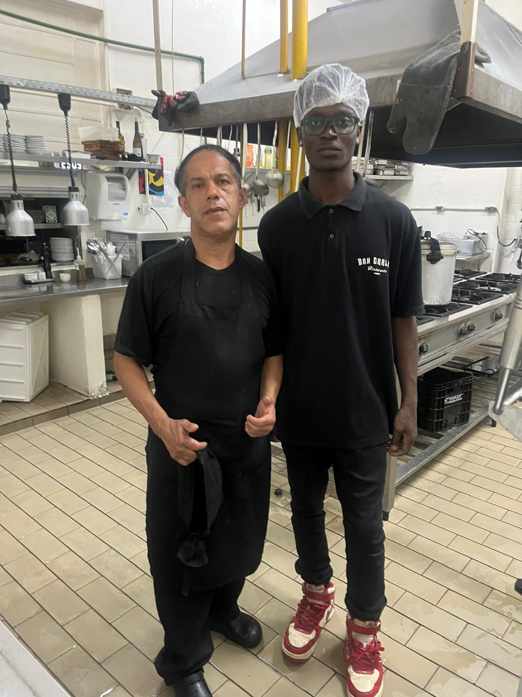
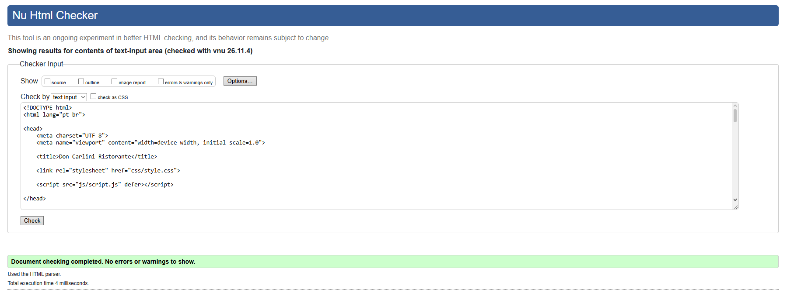

# projeto-html-don-carlini

# Autor e Colaboradores

Desenvolvido por Caique Martins Santos,
Antonio Nsona Senga, 
Aquiles Santana da Silva,
Erin Jesus Olivera Calvi.

# Don Carlini Ristorante

Site institucional do "Don Carlini Ristorante", desenvolvido em HTML, CSS e Javascript

# Sobre o projeto

O Don Carlini Ristorante é um projeto acadêmico de desenvolvimento web que consiste na criação de um site institucional para o restaurante Don Carlini Ristorante. A proposta é desenvolver uma plataforma digital que apresente o estabelecimento de maneira organizada, atrativa e acessível, permitindo que clientes e pessoas interessadas conheçam melhor o restaurante, seus serviços, seu ambiente e suas opções gastronômicas.

O projeto surgiu com o objetivo de proporcionar ao restaurante uma presença digital por meio de um site que reúna, em um único lugar, informações importantes para seus visitantes.

# Visita a empresa

Durante o desenvolvimento do projeto un dos integrantes do grupo realizou uma visita ao Don Carlini Ristorante, com o objetivo de conhecer melhor o estabelecimento e obter informações que pudessem contribuir para a elaboração do projeto.



# Desenvolvimento do site
O desenvolvimento do site teve como objetivo criar uma página institucional para o Don Carlini Ristorante, permitindo que os visitantes conhecessem o estabelecimento, consultassem seu cardápio e encontrassem informações importantes para entrar em contato ou solicitar uma reserva.

Inicialmente, foi realizada uma análise das informações disponíveis sobre o restaurante, considerando sua identidade, seus serviços, seu ambiente e os conteúdos que seriam relevantes para os clientes. Também foram utilizadas informações e imagens relacionadas ao estabelecimento para aproximar a apresentação do site da realidade do restaurante.

# Identidade visual
Antes da implementação, foram observados sites institucionais de restaurantes, especialmente estabelecimentos da área gastronômica italiana. Essa pesquisa serviu como referência para identificar elementos comuns nesse tipo de website, como imagens de pratos em destaque, menus de navegação no topo da página, apresentação do estabelecimento, organização do cardápio e áreas destinadas a contato e reservas.
Durante a elaboração do site, foram considerados diferentes aspectos visuais para que a aparência estivesse de acordo com a proposta de um restaurante italiano.

A paleta de cores foi definida com base em tons que transmitem elegância, tradição e aconchego. Foram utilizados:

- Bege: utilizado como cor de fundo em determinadas áreas, proporcionando uma aparência acolhedora.

- Cinza-escuro: utilizado principalmente no cabeçalho e no rodapé, criando contraste com os demais elementos.

- Dourado: utilizado em detalhes e efeitos visuais para transmitir sofisticação.

- Vermelho-escuro: utilizado nos botões e em elementos de destaque.

Também foram realizados ajustes na disposição dos elementos, nos espaçamentos, nos tamanhos das imagens e na apresentação dos textos. As imagens de fundo das seções principais foram diferenciadas de acordo com o conteúdo de cada página, mantendo um padrão visual entre elas.

Na tipografia, foi adotada a fonte Merriweather como referência para a apresentação dos textos, buscando uma aparência tradicional e adequada à identidade do restaurante.

Essas escolhas foram ajustadas durante a implementação, observando a legibilidade dos textos, o contraste entre as cores e a organização dos elementos em diferentes tamanhos de tela.

# Desenvolvimento com IA 
Durante o desenvolvimento do projeto, o grupo utilizou ferramentas de Inteligência Artificial como apoio às atividades de programação, organização do conteúdo e resolução de dúvidas técnicas.
A utilização da IA teve como principais objetivos:

- Auxiliar na elaboração e organização da estrutura HTML.

- Esclarecer dúvidas sobre elementos semânticos e boas práticas de desenvolvimento.

- Sugerir melhorias para a aparência e a organização dos estilos CSS.

- Auxiliar na implementação de funcionalidades com JavaScript.

- Identificar possíveis erros e sugerir correções.

- Melhorar a clareza e a organização dos textos apresentados no site.


# Estrutura de pastas

projeto-html-don-carlini/
├── index.html
├── README.md
├── LICENSE
├── assets/
│   ├── img/
│   │   ├── avaliacao.jpg
│   │   ├── canelone-molho-branco.jpg.jpeg
│   │   ├── cardapio.jpg
│   │   ├── contatos.jpg
│   │   ├── corredor-entrada.jpg
│   │   ├── fachada-entrada.jpg.jpeg
│   │   ├── fachada-patio.jpg
│   │   ├── faq.png
│   │   ├── fettuccine-camarao.jpg
│   │   ├── galeria.png
│   │   ├── logoDonCarlini.jpg
│   │   ├── prato.webp
│   │   ├── ravioli-molho-tomate.jpg.jpeg
│   │   ├── reservas.png
│   │   ├── salao-bar.jpg
│   │   ├── salao-interno.jpg.jpeg
│   │   ├── sobrenos.jpg
│   │   ├── termouso.jpg
│   │   └── trabcon.jpg
│   └── video/
│       ├── donCarliniVideo1.mp4
│       ├── donCarliniVideo2.mp4
│       └── donCarliniVideo3.mp4
├── css/
│   └── style.css
├── js/
│   └── script.js
├──docs/
│    ├── validacaoW3C.png
│    └── visita.jpeg
└── pages/
    ├── avaliacoes.html
    ├── cardapio.html
    ├── contatos.html
    ├── faq.html
    ├── galeria.html
    ├── reservas.html
    ├── sobreNos.html
    ├── termosUso.html
    └── trabalheCon.html

# Funcionalidades

O site do Don Carlini Ristorante foi desenvolvido com diferentes funcionalidades para facilitar a navegação, apresentar informações sobre o estabelecimento e proporcionar formas de interação aos visitantes. Cada recurso foi organizado de acordo com a finalidade de sua respectiva página, mantendo uma identidade visual padronizada em todo o website.

As principais funcionalidades implementadas são:

1. Navegação entre páginas

- Menu de navegação localizado no cabeçalho, permitindo acessar todas as páginas do site.

- Links organizados para facilitar a localização das informações.

- Identidade visual padronizada entre as páginas, mantendo a consistência da navegação.

- Destaque visual para elementos interativos, como links e botões, por meio de efeitos de interação.

2. Apresentação institucional

- Página inicial com apresentação do restaurante e acesso às principais seções.

- Página Sobre Nós com informações sobre o estabelecimento, sua proposta e seus diferenciais.

- Seções com textos e imagens para apresentar a identidade do restaurante.

- Imagens de fundo específicas para os destaques principais de cada página, contribuindo para uma apresentação visual mais atrativa.

3. Cardápio digital

- Apresentação dos pratos oferecidos pelo restaurante.

- Organização dos itens em categorias, como pratos principais, bebidas e sobremesas.

- Descrições dos alimentos para facilitar o conhecimento das opções disponíveis.

- Utilização de imagens para complementar a apresentação dos pratos.

4. Sistema demonstrativo de reservas

- Formulário para preenchimento dos dados do cliente.

- Campos para informar nome completo, e-mail, telefone, data, horário e quantidade de pessoas.

- Campo adicional para observações relacionadas à solicitação.

- Validação dos campos obrigatórios e dos formatos de dados.

- Exibição de uma mensagem de confirmação após o preenchimento válido do formulário.

- Opção para limpar os campos por meio do botão de redefinição.

5. Sistema de avaliações

- Exibição de avaliações demonstrativas organizadas em cartões.

- Apresentação do nome do avaliador, da nota em estrelas e do comentário.

-Formulário para adicionar novas avaliações.

- Seleção de uma nota de 1 a 5 estrelas.

- Verificação dos campos obrigatórios antes da inclusão da avaliação.

- Adição dinâmica da nova avaliação abaixo das avaliações já existentes, utilizando JavaScript.

- Limpeza automática dos campos após a inclusão da avaliação.

6. Galeria de imagens e vídeos

- Exibição de fotografias do ambiente do restaurante.

- Apresentação visual de pratos e opções gastronômicas.

- Inclusão de vídeos relacionados ao estabelecimento.

- Organização dos arquivos de mídia em seções para facilitar a visualização.

7. Formulário de contato

- Apresentação de informações de contato do restaurante.

- Campos para preenchimento de nome, e-mail, telefone, assunto e mensagem.

- Validação dos dados obrigatórios antes da conclusão do formulário.

- Exibição de uma mensagem de confirmação após o preenchimento válido.

8. Perguntas frequentes

- Organização das dúvidas mais comuns dos visitantes.

- Apresentação de respostas relacionadas ao funcionamento e aos serviços do restaurante.

- Estruturação do conteúdo em perguntas e respostas para facilitar a consulta.

9. Termos de uso

- Apresentação das condições gerais de utilização do site.

- Informações sobre o uso dos conteúdos e das funcionalidades disponibilizadas.

- Orientações relacionadas aos formulários, avaliações e informações apresentadas na plataforma.

10. Formulário Trabalhe Conosco

- Formulário destinado a pessoas interessadas em oportunidades profissionais no restaurante.

- Campos para preenchimento de informações pessoais e profissionais.

- Possibilidade de informar a área de interesse, experiências e outras informações relevantes.

- Campo opcional para inserir um endereço de currículo.

- Validação dos campos obrigatórios.

- Exibição de uma mensagem de confirmação após o preenchimento válido.

11. Validação e interatividade

- Utilização de recursos de validação nativos do HTML5 para verificar os dados inseridos nos formulários.

- Implementação de funcionalidades em JavaScript para controlar o comportamento dos formulários.

- Exibição de mensagens de sucesso, aviso ou erro de acordo com a situação.

- Utilização de efeitos visuais e transições para melhorar a experiência de navegação.

- Verificação da estrutura HTML por meio do W3C Validator.

# Tecnologias utilizadas

- HTML5 — estrutura e conteúdo de todas as páginas
- CSS3 — estilização das páginas, definição de cores, fontes, layouts, espaçamentos, responsividade e transições visuais.
- JavaScript — implementação de interatividade, validações e funcionalidades dos formulários, incluindo a exibição dinâmica das avaliações enviadas pelos usuários.
- ChatGPT e Claude — Utilizado para auxílio de programação e organização do projeto.

# Validação W3C 

Verificamos o código no W3C Validator usando de base o index.html, o Validator apresentou erros que tinha então os corrigimos e validamos novamente e o código não apresentava mais nenhum erro ou inconsistência e com base no index fizemos e corrigimos as outras páginas.



# Como executar o projeto

Como é um site estático, não é necessário instalar dependências.

1. Clone ou baixe este repositório
2. Abra o arquivo `index.html` diretamente no navegador

   ou

3. Use uma extensão como Live Server (VS Code) para rodar com recarregamento automático:
   ```
   Botão direito em index.html > Open with Live Server
   ```

Ou basta utilizar o link público do site no GitHub Pages

# Conclusão
O desenvolvimento do site institucional do Don Carlini Ristorante proporcionou ao grupo a oportunidade de aplicar, na prática, os conhecimentos adquiridos durante os estudos de desenvolvimento web.

Ao longo do projeto, foi possível compreender melhor como organizar páginas utilizando HTML5, desenvolver identidades visuais com CSS3 e implementar funcionalidades interativas por meio do JavaScript.


